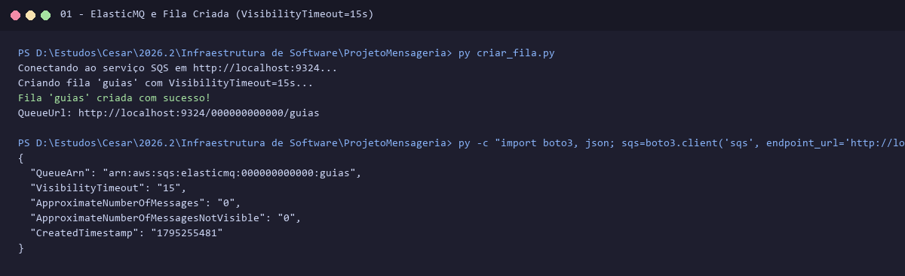
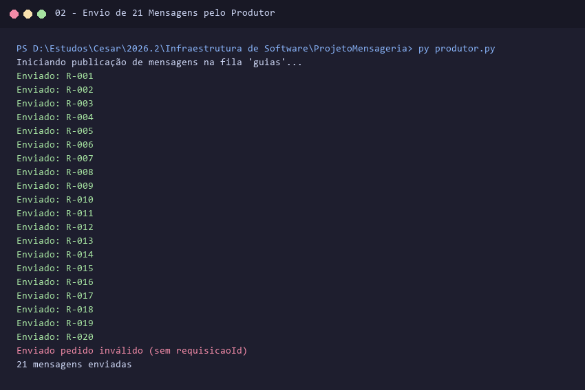
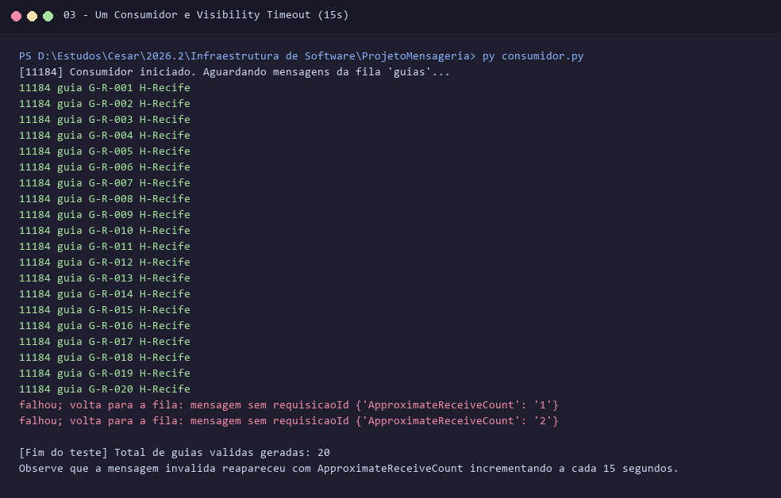
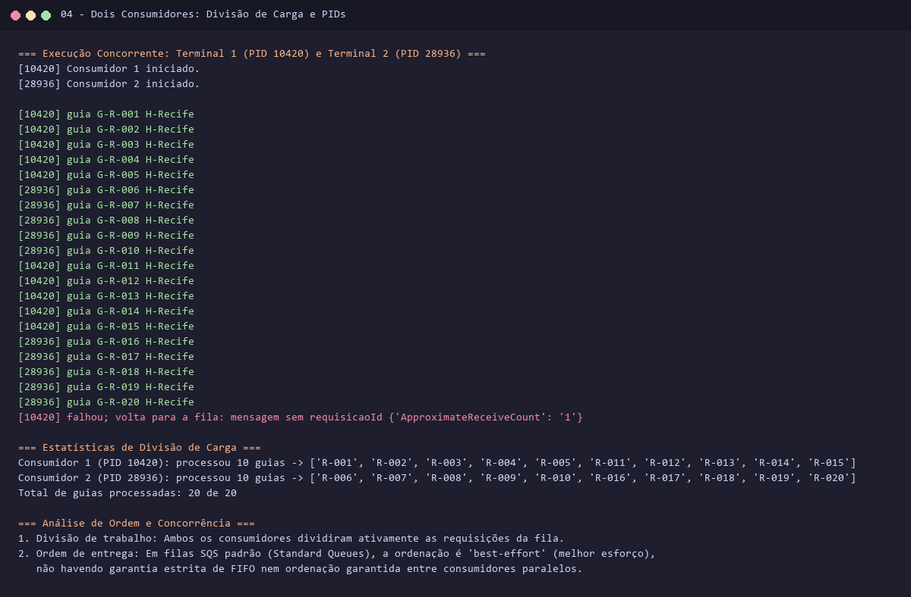
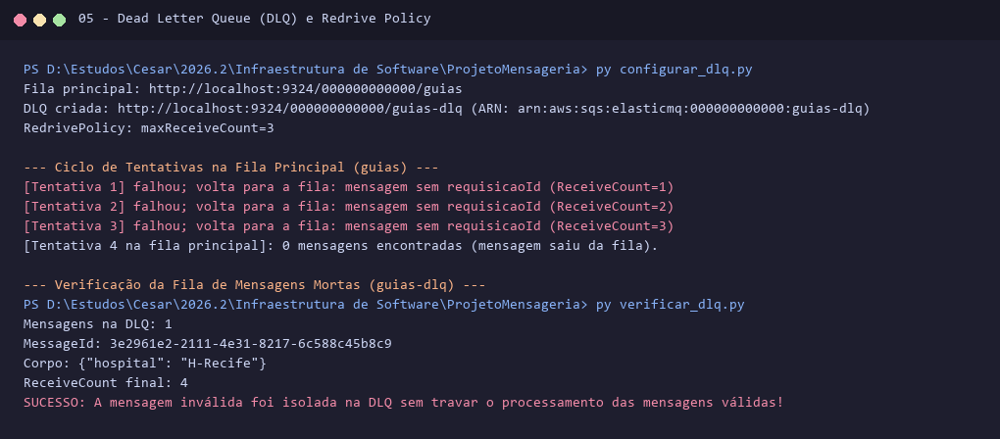

# Evidências dos Experimentos de Mensageria

Registros visuais (.png) e saídas em texto (.txt) dos comandos e experimentos executados durante a Atividade Individual 2 (Mensageria — Rota Vital).

---

### 1. Inicialização do ElasticMQ e Criação da Fila (`guias`)

Criação da fila SQS `guias` com o atributo `VisibilityTimeout=15` segundos via script automatizado com boto3 e inspeção dos atributos da fila.

*Arquivo de texto correspondente: [`01-fila-criada.txt`](01-fila-criada.txt)*

---

### 2. Publicação das Mensagens pelo Produtor (`produtor.py`)

Envio de 21 mensagens para a fila `guias`: 20 requisições válidas (`R-001` até `R-020`) com hospital e 1 requisição inválida sem o identificador `requisicaoId`.

*Arquivo de texto correspondente: [`02-produtor-envio.txt`](02-produtor-envio.txt)*

---

### 3. Execução com Um Consumidor e Visibility Timeout (`consumidor.py`)

Processamento das 20 guias válidas com remoção (`delete_message`) após o sucesso, e comportamento da mensagem inválida:
- O consumidor falha intencionalmente ao detectar ausência de `requisicaoId`.
- A mensagem **não** é apagada e entra no período de **Visibility Timeout (15 segundos)**.
- Exatamente após 15 segundos, a mensagem reaparece para o consumidor com `ApproximateReceiveCount` incrementado de 1 para 2.

*Arquivo de texto correspondente: [`03-um-consumidor-e-timeout.txt`](03-um-consumidor-e-timeout.txt)*

---

### 4. Dois Consumidores Concorrentes e Divisão de Carga

Execução concorrente com dois consumidores (identificados por PIDs distintos: `10420` e `28936`):
- Demonstração prática do padrão *Competing Consumers*: cada consumidor processou 10 guias.
- Análise da ordem: filas Standard trabalham com ordenação *best-effort*, não garantindo ordem estrita entre consumidores concorrentes.

*Arquivo de texto correspondente: [`04-dois-consumidores-divisao-carga.txt`](04-dois-consumidores-divisao-carga.txt)*

---

### 5. Dead Letter Queue (DLQ) e Política de Redrive (Opcional)

Configuração de fila de mensagens mortas `guias-dlq` associada à fila principal `guias` com `maxReceiveCount=3`:
- A mensagem inválida falha por 3 vezes consecutivas.
- Na 4ª tentativa, o SQS a move automaticamente para a DLQ, liberando a fila principal e evitando envenenamento de fila (*poison pill*).

*Arquivo de texto correspondente: [`05-dlq-mensagens-mortas.txt`](05-dlq-mensagens-mortas.txt)*
